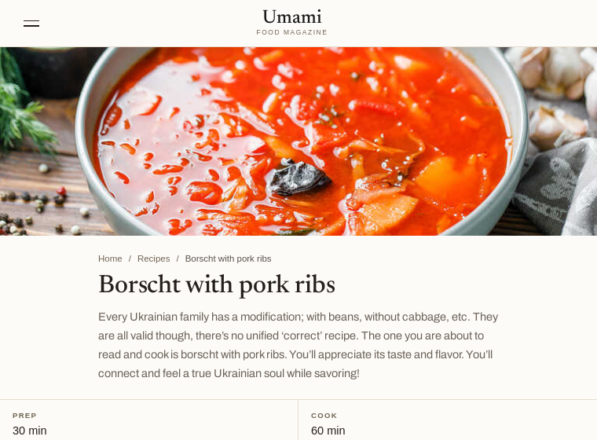

# Druxt on decoupled-drupal-mock: Umami

A [Druxt](https://druxtjs.org) site running on Drupal's Umami demo content, with no Drupal site, in the look of the [Umami demo](https://umami.demo.druxtjs.org). The backend is [decoupled-drupal-mock](https://github.com/Decipher/decoupled-drupal-mock)'s Umami preset: Drupal 11's JSON:API, Decoupled Router and menu answers, recorded from a real install and served by the mock.

[](https://stackblitz.com/github/druxt/druxt-drupal-mock-umami?file=nuxt.config.js)

[Open in StackBlitz](https://stackblitz.com/github/druxt/druxt-drupal-mock-umami?file=nuxt.config.js). The first start takes a couple of minutes: StackBlitz installs the packages, starts the mock and builds the site in your browser.

## Run it

```sh
npm install
npm run dev
```

`npm run dev` starts the mock on port 3005, waits for it to answer, then starts Nuxt on port 3000. Open http://localhost:3000/recipes/borscht-with-pork-ribs, and switch to Spanish at `/es`.

The browser never talks to the mock directly. Every Drupal request goes through the site's own origin, proxied to the mock in `nuxt.config.js`, so the same setup works in StackBlitz, where the preview can't reach another port.

## What's in it

- `nuxt.config.js`: Druxt pointed at the mock, with the proxy for JSON:API, the Decoupled Router and Drupal's files, and the query settings the Umami components expect.
- `scripts/dev.mjs`: starts the mock and Nuxt together.
- `vendor/druxt-umami-ui-0.1.0-e6ffccb.tgz`: [`druxt-umami-ui`](https://github.com/druxt/druxt-umami-ui), the Umami demo's theme, layout and Druxt components, packed from commit `e6ffccb` on its `0.x` branch. It isn't on npm yet, and StackBlitz can't download a tarball from GitHub, so the packed package ships here. To update it, run `npm pack` in a checkout of druxt-umami-ui and replace the file.
- `overlays/language-routing-patches.json.gz`: the preset records Drupal's released modules only. This overlay, from the mock's repository, records the two language-routing patches Druxt relies on, [Decoupled Router #3111456](https://www.drupal.org/i/3111456) and [Druxt #3273228](https://www.drupal.org/i/3273228), so `/es` paths resolve.

The site is read-only. The mock's control routes, for signing in and resetting writes in tests, are left off.

## Versions

This branch, `0.x`, runs Druxt 0.x on Nuxt 2. Nuxt 2's webpack 4 needs Node's legacy OpenSSL provider on Node 17 and later, which `scripts/dev.mjs` sets. A Druxt 2.x version follows the 2.0.0 release.
